# 📊 Dokumentasi Komprehensif Activity Diagram: Sistem Apotek Hadinata Digital (Capstone)

Dokumen ini memuat **seluruh Activity Diagram (Diagram Aktivitas UML)** untuk **semua fitur** pada sistem Apotek Hadinata. Setiap diagram dirancang dengan prinsip *software engineering* formal, membagi peran (*swimlane*), dan **terhubung secara langsung dengan 19 entitas tabel pada Entity Relationship Diagram (ERD)** database MySQL.

---

## Daftar Fitur & Diagram

1. [Peta Arsitektur Global Alur Bisnis Apotek Hadinata](#1-peta-arsitektur-global-alur-bisnis-apotek-hadinata)
2. [Matriks Penelusuran (Traceability Matrix) 19 Tabel ERD](#2-matriks-penelusuran-traceability-matrix-19-tabel-erd)
3. [Fitur 1: Autentikasi Pengguna & Registrasi Berbasis Peran (RBAC)](#fitur-1-autentikasi-pengguna--registrasi-berbasis-peran-rbac)
4. [Fitur 2: Manajemen Profil Pribadi & Buku Alamat Pelanggan](#fitur-2-manajemen-profil-pribadi--buku-alamat-pelanggan)
5. [Fitur 3: Manajemen Master Data Obat & Upload Foto Kemasan](#fitur-3-manajemen-master-data-obat--upload-foto-kemasan)
6. [Fitur 4: Manajemen Kloter Multi-Batch FEFO & Peringatan Kedaluwarsa](#fitur-4-manajemen-kloter-multi-batch-fefo--peringatan-kedaluwarsa)
7. [Fitur 5: Pencarian Katalog Obat & Manajemen Keranjang Belanja](#fitur-5-pencarian-katalog-obat--manajemen-keranjang-belanja)
8. [Fitur 6: Checkout Pemesanan Online, Deteksi GPS, & Alokasi Stok FEFO](#fitur-6-checkout-pemesanan-online-deteksi-gps--alokasi-stok-fefo)
9. [Fitur 7: Pembayaran Midtrans Snap, Webhook SHA-512, & Simulasi Sandbox](#fitur-7-pembayaran-midtrans-snap-webhook-sha-512--simulasi-sandbox)
10. [Fitur 8: Validasi & Persetujuan (ACC) Pesanan oleh Admin/Apoteker](#fitur-8-validasi--persetujuan-acc-pesanan-oleh-adminapoteker)
11. [Fitur 9: Pengantaran Kurir Internal, Shift Gelombang, & Penanganan Gagal](#fitur-9-pengantaran-kurir-internal-shift-gelombang--penanganan-gagal)
12. [Fitur 10: Kasir Gerai Offline (Point of Sale / POS) & Cetak Nota](#fitur-10-kasir-gerai-offline-point-of-sale--pos--cetak-nota)
13. [Fitur 11: Pembatalan Pesanan Mandiri Pelanggan & Pemulihan Stok FEFO](#fitur-11-pembatalan-pesanan-mandiri-pelanggan--pemulihan-stok-fefo)
14. [Fitur 12: Layanan Live Chat Konsultasi Apoteker & Notifikasi Real-Time](#fitur-12-layanan-live-chat-konsultasi-apoteker--notifikasi-real-time)
15. [Fitur 13: Konfigurasi Parameter Apotek & Audit Trail Aktivitas Admin](#fitur-13-konfigurasi-parameter-apotek--audit-trail-aktivitas-admin)
16. [Fitur 14: Manajemen Akun Staf & Penugasan Peran oleh Admin](#fitur-14-manajemen-akun-staf--penugasan-peran-oleh-admin)

---

## 1. Peta Arsitektur Global Alur Bisnis Apotek Hadinata

Diagram makro yang memperlihatkan bagaimana tiga aktor utama (Pelanggan, Admin/Apoteker, Kurir) berinteraksi dengan dua saluran penjualan (Online E-Commerce dan Offline Kasir POS) yang bermuara pada satu basis data inventori obat terintegrasi berbasis FEFO:

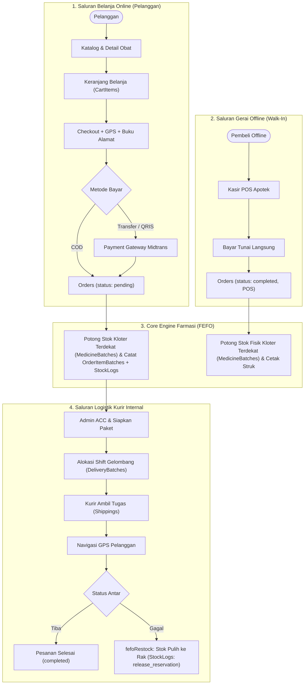

---

## 2. Matriks Penelusuran (Traceability Matrix) 19 Tabel ERD

| No | Nama Tabel ERD | Model File | Fitur yang Mengakses / Memodifikasi |
| :---: | :--- | :--- | :--- |
| 1 | `Users` | `user.js` | Fitur 1, 2, 8, 9, 12, 14 |
| 2 | `CustomerAddresses` | `customerAddress.js` | Fitur 2, 6 |
| 3 | `Categories` | `category.js` | Fitur 3, 5 |
| 4 | `Medicines` | `medicine.js` | Fitur 3, 4, 5, 6, 10 |
| 5 | `MedicineBatches` | `medicineBatch.js` | Fitur 4, 6, 9, 10, 11 |
| 6 | `StockLogs` | `stockLog.js` | Fitur 4, 6, 9, 10, 11 |
| 7 | `CartItems` | `cartItem.js` | Fitur 5, 6 |
| 8 | `Orders` | `order.js` | Fitur 6, 7, 8, 9, 10, 11 |
| 9 | `OrderItems` | `orderItem.js` | Fitur 6, 8, 10, 11 |
| 10 | `OrderItemBatches` | `orderItemBatch.js` | Fitur 6, 9, 10, 11 |
| 11 | `Payments` | `payment.js` | Fitur 6, 7, 8, 9, 10 |
| 12 | `Shippings` | `shipping.js` | Fitur 8, 9 |
| 13 | `DeliveryBatches` | `deliveryBatch.js` | Fitur 9 |
| 14 | `OrderStatusHistories`| `orderStatusHistory.js`| Fitur 6, 7, 8, 9, 11 |
| 15 | `ChatRooms` | `chatRoom.js` | Fitur 12 |
| 16 | `ChatMessages` | `chatMessage.js` | Fitur 12 |
| 17 | `Notifications` | `notification.js` | Fitur 4, 6, 7, 8, 9, 11, 12 |
| 18 | `SystemSettings` | `systemSetting.js` | Fitur 6, 10, 13 |
| 19 | `ActivityLogs` | `activityLog.js` | Fitur 3, 4, 10, 13, 14 |

---

## Fitur 1: Autentikasi Pengguna & Registrasi Berbasis Peran (RBAC)

Memastikan pencegahan eskalasi hak akses (*privilege escalation*) di mana registrasi publik mutlak dikunci ke peran `user`, sedangkan staf internal dibuat oleh admin.

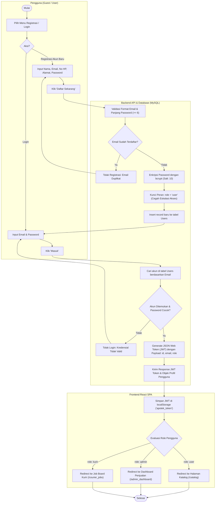

---

## Fitur 2: Manajemen Profil Pribadi & Buku Alamat Pelanggan

Pengelolaan identitas biodata dan buku alamat multi-lokasi (*CustomerAddresses*) untuk mempermudah pemilihan titik kirim saat checkout.

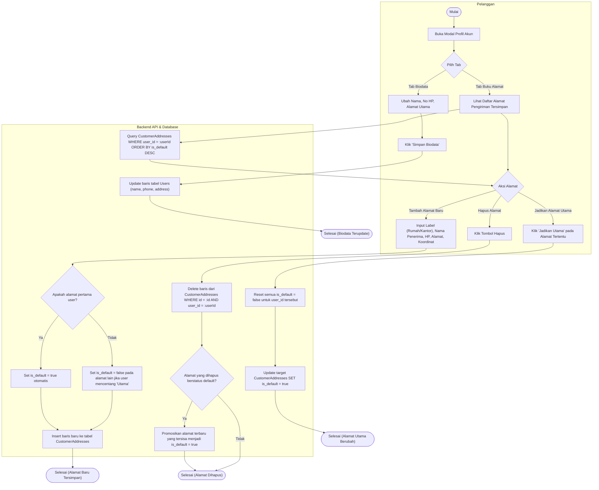

---

## Fitur 3: Manajemen Master Data Obat & Upload Foto Kemasan

Apoteker mengelola katalog obat resmi BPOM, penentuan klasifikasi (Obat Bebas, Bebas Terbatas, Suplemen), penetapan harga, SKU, serta unggah kemasan produk via Multer.

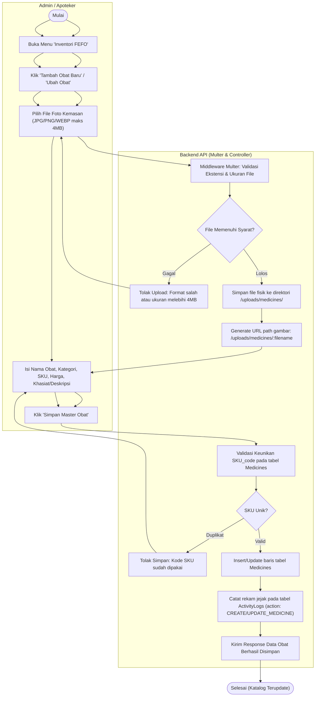

---

## Fitur 4: Manajemen Kloter Multi-Batch FEFO & Peringatan Kedaluwarsa

Mengakomodasi penerimaan pasokan obat dari distributor PBF (*Pedagang Besar Farmasi*), pencatatan nomor *batch*, tanggal kedaluwarsa, dan pemicu peringatan stok otomatis.

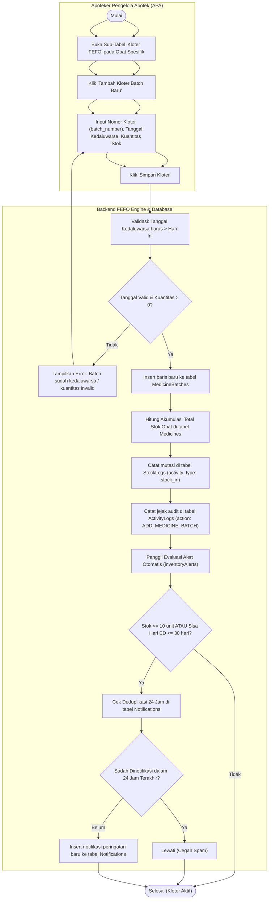

---

## Fitur 5: Pencarian Katalog Obat & Manajemen Keranjang Belanja

Pelanggan mencari obat, memfilter kategori, melihat transparansi masa kedaluwarsa terdekat, dan mengelola isi keranjang belanja secara real-time.

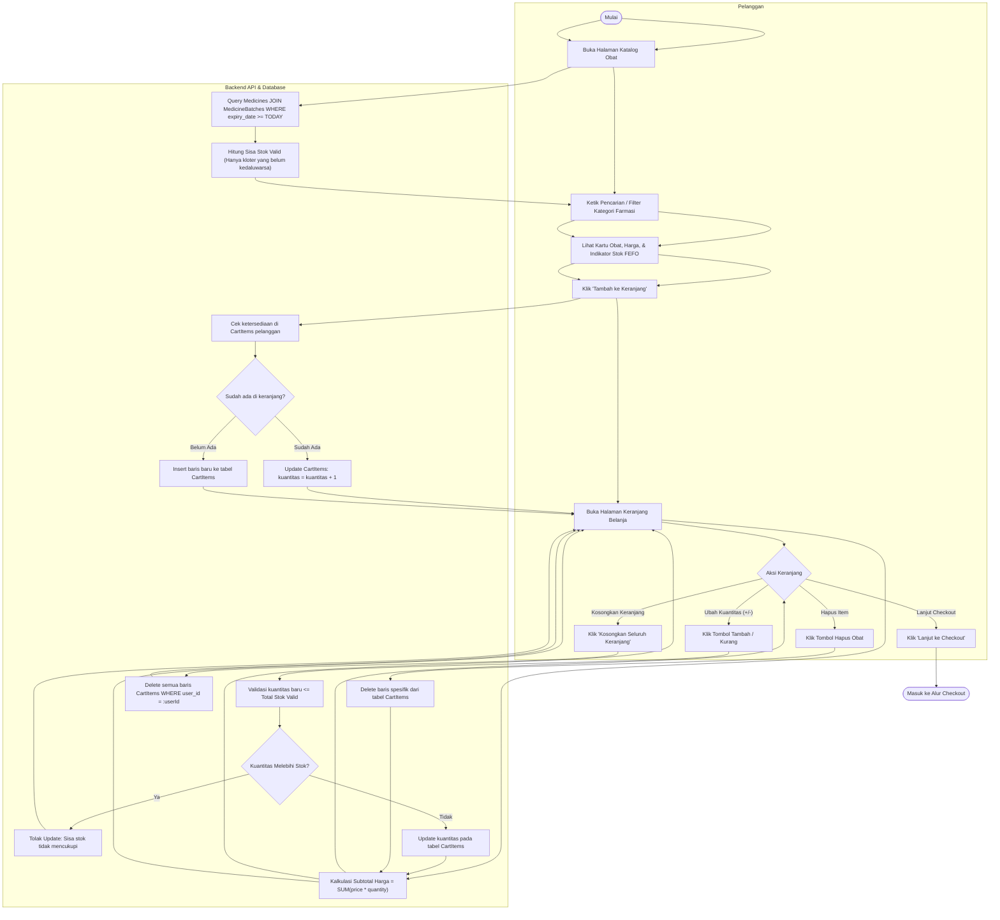

---

## Fitur 6: Checkout Pemesanan Online, Deteksi GPS, & Alokasi Stok FEFO

Pemisahan alur pemesanan online pelanggan dengan validasi stok multi-kloter (*First Expire First Out*), deteksi titik koordinat pengantaran, dan kalkulasi ongkos kirim dinamis.

```mermaid
flowchart TD
    subgraph CustomerCheckout ["Pelanggan (Checkout)"]
        CO1(["Mulai"]) --> CO2["Pilih Alamat Tujuan dari CustomerAddresses"]
        CO2 --> CO3["Klik 'Deteksi Lokasi GPS Saya' (Opsional)"]
        CO3 --> CO4["Pilih Pembayaran: Midtrans Snap (QRIS) ATAU Bayar di Tempat (COD)"]
        CO4 --> CO5["Input Catatan Pengantaran Khusus"]
        CO5 --> CO6["Klik 'Konfirmasi & Buat Pesanan'"]
    end

    subgraph BackendTransaction ["Backend Database Transaction (ACID)"]
        BT1["Mulai Database Transaction (START TRANSACTION)"]
        BT2["Ambil data SystemSettings (tarif ongkir default & ambang gratis ongkir)"]
        BT3["Hitung Ongkos Kirim: Jika Subtotal >= free_shipping_min_order maka Ongkir = 0, selain itu default"]
        BT4["Ambil Semua Kloter Obat Aktif (MedicineBatches) dengan PENGUNCIAN: ORDER BY expiry_date ASC FOR UPDATE"]
        BT5{"Apakah Total Stok Fisik Masih Cukup?"}
        BT6["ROLLBACK Transaksi & Kembalikan Error: Stok obat habis terambil pembeli lain"]
        BT7["Insert Header Transaksi ke tabel Orders (order_status: pending, payment_status: unpaid)"]
        BT8["Loop setiap produk keranjang: Insert ke tabel OrderItems"]
        BT9["Eksekusi Algoritma FEFO:<br/>Alokasikan pemotongan kuantitas ke MedicineBatches dengan ED terdekat lebih dulu"]
        BT10["Catat alokasi kloter spesifik pada tabel OrderItemBatches"]
        BT11["Kurangi kolom stock pada tabel MedicineBatches"]
        BT12["Catat jejak pemotongan pada tabel StockLogs (activity_type: stock_out, notes: FEFO Checkout #orderId)"]
        BT13["Buat baris baru di tabel OrderStatusHistories (status: pending)"]
        BT14["Hapus seluruh isi tabel CartItems milik pelanggan"]
        BT15{"Pilihan Metode Pembayaran?"}
        BT16["Inisialisasi Midtrans Snap API & Simpan tabel Payments (method: QRIS, status: unpaid)"]
        BT17["Simpan langsung ke tabel Payments (method: COD, status: unpaid)"]
        BT18["COMMIT Transaksi Database"]
        BT19["Buat Notifikasi Pesanan Baru di tabel Notifications untuk Admin Apotek"]
    end

    CO1 --> CO2 --> CO3 --> CO4 --> CO5 --> CO6 --> BT1
    BT1 --> BT2 --> BT3 --> BT4 --> BT5
    BT5 -- "Tidak" --> BT6 --> CO6
    BT5 -- "Ya" --> BT7 --> BT8 --> BT9 --> BT10 --> BT11 --> BT12 --> BT13 --> BT14 --> BT15
    BT15 -- "Midtrans" --> BT16 --> BT18
    BT15 -- "COD" --> BT17 --> BT18
    BT18 --> BT19 --> CO_FIN(["Pesanan Dibuat & Menunggu Pembayaran/ACC"])
```

---

## Fitur 7: Pembayaran Midtrans Snap, Webhook SHA-512, & Simulasi Sandbox

Menjamin integritas verifikasi pembayaran digital dengan validasi *Signature Key* SHA-512, pembaruan status lunas, serta simulasi lokal untuk keperluan presentasi sidang tanpa ketergantungan tunnel eksternal.

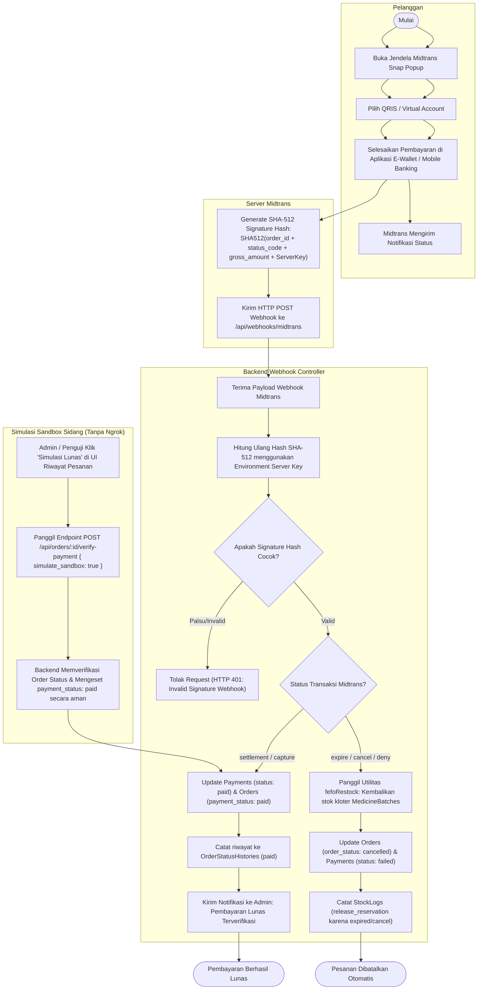

---

## Fitur 8: Validasi & Persetujuan (ACC) Pesanan oleh Admin/Apoteker

Apoteker memvalidasi kelayakan pesanan, memastikan kepatuhan resep/indikasi, dan meneruskan pesanan berstatus *processing* ke antrean logistik kurir.

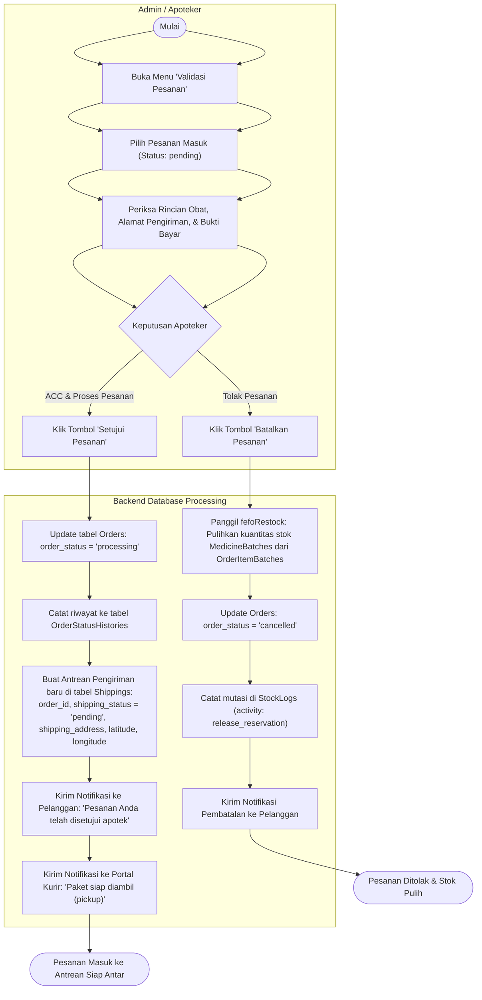

---

## Fitur 9: Pengantaran Kurir Internal, Shift Gelombang, & Penanganan Gagal

Kurir mengambil pesanan, sistem otomatis membagi ke kloter harian (*DeliveryBatches*), kurir bernavigasi dengan Google Maps, dan sistem otomatis mengembalikan stok jika terjadi kegagalan serah terima.

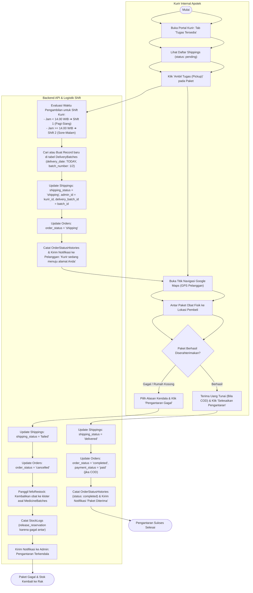

---

## Fitur 10: Kasir Gerai Offline (Point of Sale / POS) & Cetak Nota

Transaksi penjualan langsung di apotek untuk pembeli *walk-in*, pemotongan kloter FEFO seketika, kalkulasi uang kembalian, cetak struk kasir thermal 80mm, dan pencatatan audit log kasir.

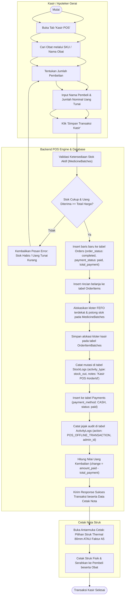

---

## Fitur 11: Pembatalan Pesanan Mandiri Pelanggan & Pemulihan Stok FEFO

Hak pelanggan untuk membatalkan pesanan yang belum diproses/dibayar tanpa perlu menghubungi admin, dengan pengembalian kuantitas obat ke kloter asal secara transaksional.

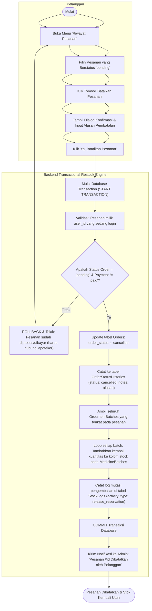

---

## Fitur 12: Layanan Live Chat Konsultasi Apoteker & Notifikasi Real-Time

Saluran komunikasi konsultasi klinis indikasi dan dosis obat dua arah antara pembeli dan apoteker jaga, serta pemusatan lonceng notifikasi akun.

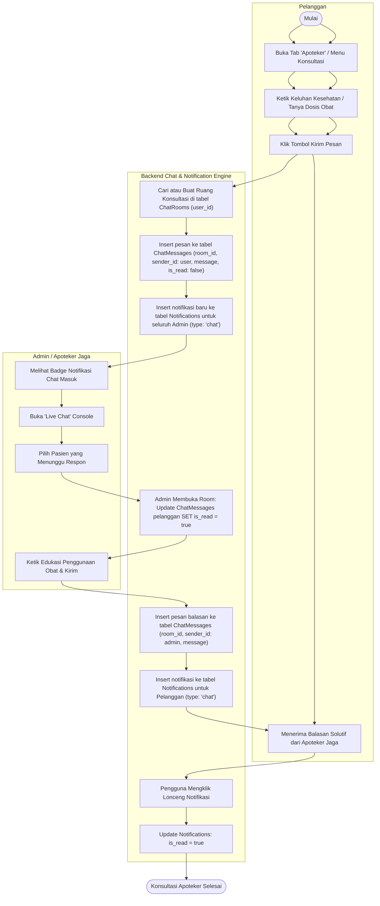

---

## Fitur 13: Konfigurasi Parameter Apotek & Audit Trail Aktivitas Admin

Pengaturan legalitas apotek, jam operasional, koordinat gerai fisik, dan tarif logistik kurir dinamis yang otomatis tersinkronisasi ke header, footer, checkout, serta struk nota.

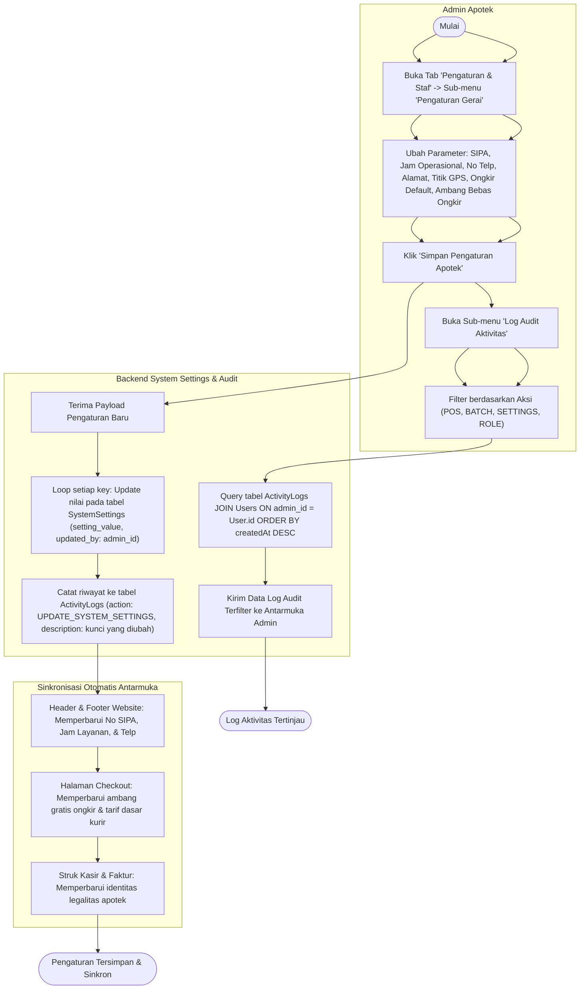

---

## Fitur 14: Manajemen Akun Staf & Penugasan Peran oleh Admin

Admin utama mengelola hak akses akun staf apotek (menambah akun staf internal, kurir, serta menaikkan/menurunkan peran akun) secara terotorisasi.

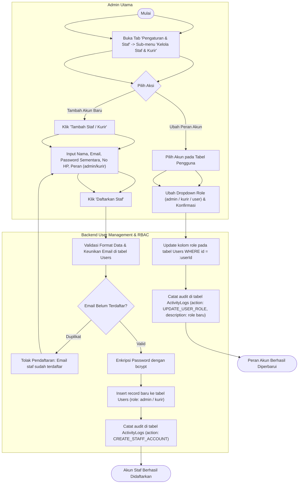

---

## Ringkasan Standar Pengujian Akademis & Sidang Skripsi

1. **Kelengkapan Fitur 100%:** Mencakup seluruh 14 fitur sistem dari hulu ke hilir (Registrasi, Profil, Katalog, Keranjang, Checkout, Midtrans, Verifikasi, Logistik Kurir, Kasir POS, Pembatalan FEFO, Live Chat, Notifikasi, Pengaturan Apotek, dan Manajemen Staf).
2. **Keterlacakan ERD Eksplisit:** Setiap *node* proses backend menyebutkan secara presisi tabel mana yang di-*query* (`SELECT`), dibuat (`INSERT`), diperbarui (`UPDATE`), atau dihapus (`DELETE`).
3. **Kepatuhan Terhadap Regulasi Farmasi & Keamanan:** Menyajikan algoritma rotasi mutasi obat **FEFO**, proteksi pembatalan mandiri, validasi *hash signature* webhook pembayaran, serta jejak audit lengkap (*ActivityLogs* & *StockLogs*).
